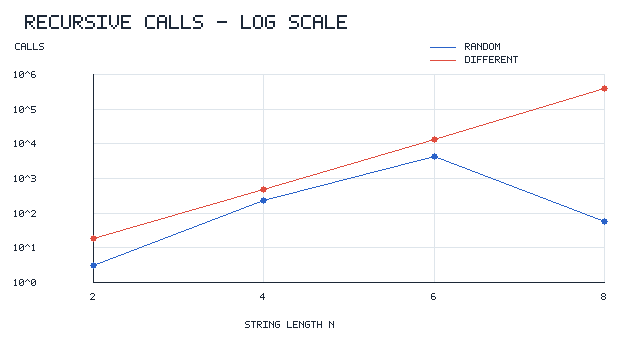
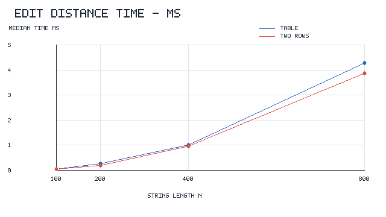
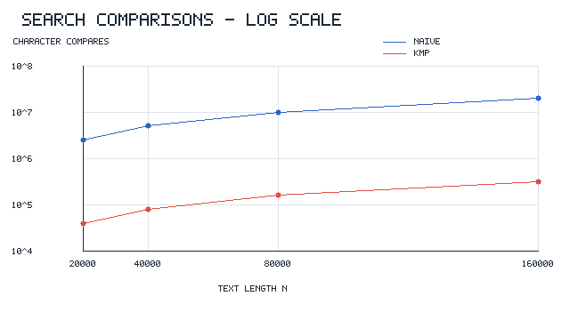

# DAA Assignment 4 - Report

## Experiment Design Card

| Field | My plan |
|---|---|
| Question | How does the input size change the cost of Edit Distance? How different are Naive and KMP on random and difficult texts? |
| Sizes (n) | Recursive: 2, 4, 6, 8. Table and Two Rows: 100, 200, 400, 800. Search: 20000, 40000, 80000, 160000. I used smaller strings for recursion because it repeats many calls. |
| Inputs | Edit Distance: random strings and two completely different strings (`AAAA...` and `BBBB...`). Search: random text/pattern and difficult text `AAAA...` with pattern `AAAA...AB` (128 characters). The difficult cases were chosen to make many comparisons. |
| Metrics | Time in milliseconds (median of 5 runs), number of recursive calls, number of DP cell updates, and number of character comparisons. All operation counts are increased inside the methods. |
| Prediction | Recursive Edit Distance will grow very fast on different strings. DP methods will use about n x n updates. On difficult text, Naive will repeat many comparisons, but KMP will use its LPS array to avoid them. |
| Plots | 1) Recursive calls vs string length (log axis). 2) Table vs Two Rows time. 3) Naive vs KMP comparisons (log axis). |

## How I ran the experiment

I used Java, `System.nanoTime()`, and a random generator with seed 42. Each size and input type was tested five times. I saved every run in `results/results.csv`. To compare the times, I used the median. The same input is used for Table and Two Rows, and the same text and pattern are used for Naive and KMP. Each method gets one warm-up call before its five measured runs. The pattern length in the search experiment is fixed at 128.

## Results and plots

### 1. Recursive Edit Distance

The difficult input needed 19 calls at n=2, 481 at n=4, 13,483 at n=6 and 398,593 at n=8. The log scale shows how fast the number grows. Random strings were less predictable because some letters matched, so some branches were skipped.

### 2. Full DP table vs Two Rows

Both versions calculated 10,000 cells at n=100 and 640,000 cells at n=800. Their measured times increased as the input became bigger. Two Rows uses less memory, but it still does the same number of DP updates.

### 3. Naive Search vs KMP

At n=160,000 on the difficult input, Naive made 20,463,744 comparisons, and KMP made 320,126 including LPS construction. Naive needed about 64 times more comparisons. Since the pattern stays at 128 characters, both curves grow roughly linearly with text length in this test, but their costs are very different.

## Prediction vs result

**Edit Distance.** I expected normal recursion to repeat work, and this happened on the completely different strings. At n=8 the recursive version already made almost 400 thousand calls. The Table and Two Rows versions both did n x n cell updates for strings of equal length, as predicted. Their times were not always in exactly the same ratio because time also depends on memory and Java execution.

**String Search.** I expected the difficult pattern to be slow for Naive because it almost matches at every position. The operation counters showed this clearly. KMP had much fewer comparisons due to LPS. On random input the difference was smaller, since Naive often stopped after the first few characters.

## Short answers

**1. Which input made string search slowest, and why?**

The difficult input was the slowest one for Naive. The text was only `A` characters, while the pattern ended in `B`. Naive compared many `A` characters and then failed near the end of the pattern, repeating this at every position. KMP avoided most of these repeated comparisons by using the LPS array.

**2. How large an n could recursive Edit Distance handle, and what stopped it?**

I tested recursion up to n=8 in the experiment. On the difficult strings, it already made 398,593 calls. At larger sizes the number of repeated calls grows very quickly, so I did not include them in the experiment. This was a practical size choice, not a claim that n=9 is impossible.

**3. What do you gain and lose with Two Rows?**

Two Rows needs only O(m) extra memory instead of O(n x m) for the whole table. It calculates the same Edit Distance result and still takes O(n x m) time. The disadvantage is that it does not keep all earlier rows. If I wanted to reconstruct exactly which letters were edited, the full table would be easier to use.

**4. Which string search would you choose for the city platform?**

I would choose KMP for searching long logs, especially if the text can contain repeated parts. The difficult input showed much fewer character comparisons with KMP. Naive is easier to write and can work well for short texts, but its worst cases are more expensive. For a city system that may search large files, KMP is the safer choice.

## About measured time

The time measurements were not perfectly stable. For example, the first runs may be affected by Java warm-up, memory allocation and other work on the computer. This is why I used the median of five runs and did not rely only on milliseconds. The operation counts help explain the algorithms even when their times change slightly.
